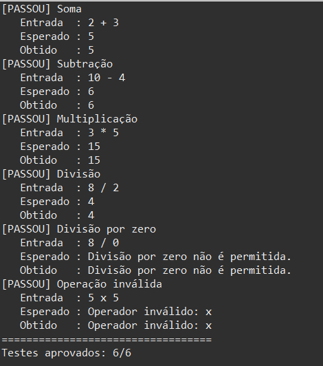

# projeto_calculadora

Módulo de calculadora em Java desenvolvido para a startup fictícia **FinançApp**, aplicativo mobile de controle de finanças pessoais.

> Atividade individual — Testes Funcionais, Refatoração e Documentação de Software
> Componente Curricular: UX/UI e Testes de Software (AS406TSN1) — UniFacens

## Descrição do projeto

O projeto implementa o núcleo de cálculos usado em funcionalidades do FinançApp, como orçamento mensal, divisão de despesas, projeção de economias e cálculos básicos do sistema. A classe `Calculadora` realiza as quatro operações fundamentais, bloqueia divisão por zero e informa operações inválidas por meio de exceções, sem interromper o aplicativo de forma inesperada.

## Objetivo da atividade

Praticar a construção, validação, manutenção e documentação de software, aplicando:

- testes funcionais e unitários;
- tratamento de erros;
- refatoração de código;
- documentação técnica com JavaDoc;
- versionamento com Git e GitHub.

## Tecnologias utilizadas

- Java 21 (compatível com Java 14 ou superior, por usar `switch` com expressões)
- JavaDoc para geração da documentação em HTML
- Git e GitHub para versionamento
- VS Code / Eclipse como IDE

## Estrutura do projeto

```
projeto_calculadora/
├── src/
│   └── calculadora/
│       ├── Calculadora.java
│       └── TesteCalculadora.java
├── docs/                 <- documentação JavaDoc (abra docs/index.html)
├── img/                  <- prints usados neste README
└── README.md
```

## Explicação das operações

O método principal é `calcular(int a, int b, String operador)` e delega cada operador para um método específico:

| Operador | Operação      | Método         | Exemplo         |
|----------|---------------|----------------|-----------------|
| `+`      | Soma          | `somar`        | 2 + 3 = 5       |
| `-`      | Subtração     | `subtrair`     | 10 - 4 = 6      |
| `*`      | Multiplicação | `multiplicar`  | 3 * 5 = 15      |
| `/`      | Divisão       | `dividir`      | 8 / 2 = 4       |

**Tratamento de erros**

- **Divisão por zero:** `dividir` lança `IllegalArgumentException` com a mensagem `Divisão por zero não é permitida.`
- **Operador inválido ou nulo:** `calcular` lança `IllegalArgumentException` com a mensagem `Operador inválido: <operador>`.

## Refatoração (branch `Refatoracao`)

Em relação à versão inicial (branch `main`), foram aplicadas as técnicas:

- **Extração de métodos:** a lógica de cada operação saiu do `if/else` gigante e foi para `somar`, `subtrair`, `multiplicar` e `dividir`.
- **Simplificação de condicionais:** o encadeamento `if / else if` virou um `switch`.
- **Melhoria de nomes:** `calc` → `calcular`, `op` → `operador`.
- **Remoção de efeito colateral:** o atributo público `r` e os `System.out.println` dentro da calculadora foram removidos; os métodos agora apenas retornam valores ou lançam exceção (métodos puros).
- **Tratamento de erros mais robusto:** erros deixam de ser apenas impressos e passam a ser exceções que quem chama pode tratar.

O comportamento observado pelo usuário permanece o mesmo: mesmos resultados nas operações válidas e erro informativo nos casos inválidos.

## Execução dos testes

Compilar e executar (na raiz do projeto):

```bash
javac -encoding UTF-8 -d out src/calculadora/*.java
java -cp out calculadora.TesteCalculadora
```

Saída obtida:

```
[PASSOU] Soma
   Entrada  : 2 + 3
   Esperado : 5
   Obtido   : 5
[PASSOU] Subtração
   Entrada  : 10 - 4
   Esperado : 6
   Obtido   : 6
[PASSOU] Multiplicação
   Entrada  : 3 * 5
   Esperado : 15
   Obtido   : 15
[PASSOU] Divisão
   Entrada  : 8 / 2
   Esperado : 4
   Obtido   : 4
[PASSOU] Divisão por zero
   Entrada  : 8 / 0
   Esperado : Divisão por zero não é permitida.
   Obtido   : Divisão por zero não é permitida.
[PASSOU] Operação inválida
   Entrada  : 5 x 5
   Esperado : Operador inválido: x
   Obtido   : Operador inválido: x
==================================
Testes aprovados: 6/6
```

### Print da execução dos testes



## Documentação JavaDoc

Para gerar a documentação (a partir da raiz do projeto):

```bash
cd src
javadoc -encoding UTF-8 -docencoding UTF-8 -charset UTF-8 -author -version -private -d ../docs calculadora/*.java
```

Depois, abra o arquivo `docs/index.html` no navegador.

### Prints da documentação JavaDoc


## Link do repositório

https://github.com/SEU_USUARIO/projeto_calculadora

## Autor

Seu Nome — RA: 000000
