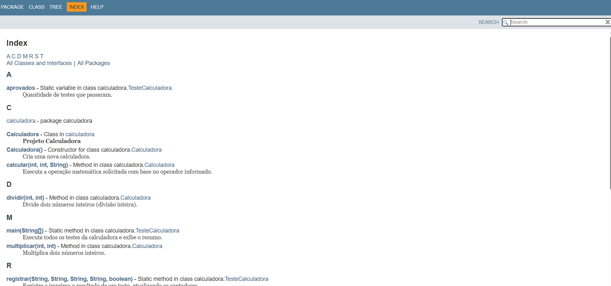
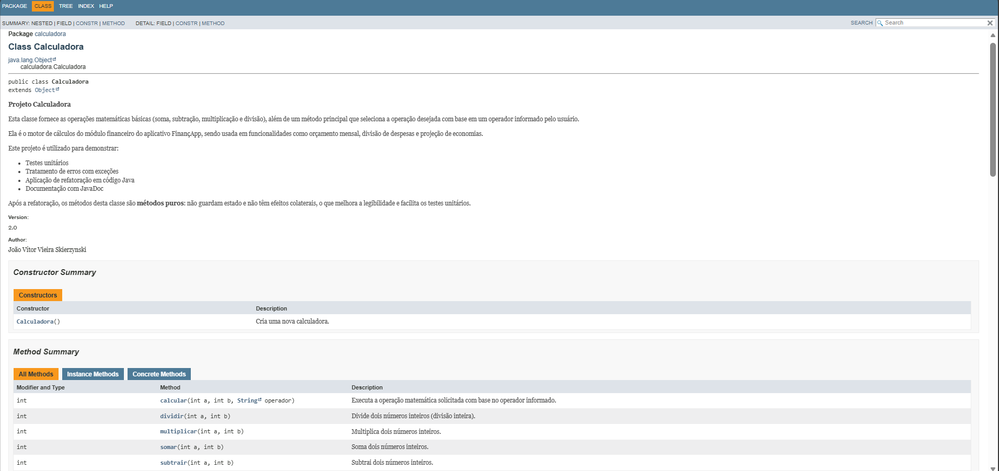
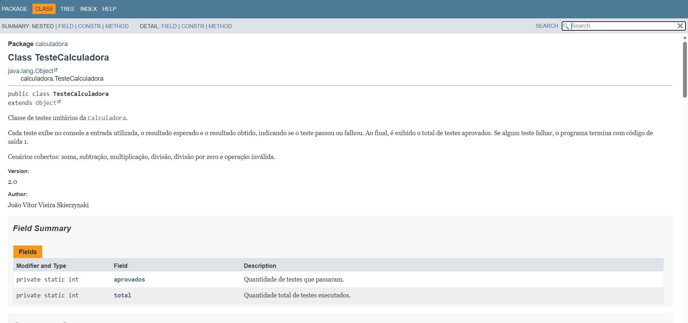

# Projeto Calculadora — FinançApp

> Projeto acadêmico desenvolvido com foco em Qualidade de Software, Testes, Refatoração, Documentação e Versionamento.

> Esta é a branch **`Refatoracao`**, com a versão refatorada, testada e documentada.

---

## 1. Identificação do Projeto

**Projeto:** Projeto Calculadora  
**Contexto:** FinançApp  
**Aluno:** João Vítor Vieira Skierzynski  
**RA:** 250964  
**Curso:** ADS (Análise e Desenvolvimento de Sistemas)  
**Disciplina:** UX/UI e Testes de Software  
**Professor:** Daniel Domingos Akira de Sa Pimentel Ohata  
**Semestre:** 2026.2  

---

# 2. Visão Geral

O projeto consiste no desenvolvimento de um módulo de cálculos matemáticos básicos em Java para a startup fictícia **FinançApp**.

O módulo foi desenvolvido com o objetivo de ser utilizado futuramente em funcionalidades de controle financeiro, como:

- orçamento mensal;
- divisão de despesas;
- projeções financeiras;
- cálculos auxiliares.

Além do funcionamento correto das operações, o projeto aplica práticas de qualidade de software relacionadas a:

- testes;
- tratamento de erros;
- refatoração;
- documentação;
- versionamento;
- manutenção de código.

---

# 3. Problema

Durante o desenvolvimento da aplicação FinançApp, foi identificada a necessidade de criar um módulo matemático reutilizável.

Entretanto, a equipe definiu que o módulo não deveria apenas funcionar corretamente, mas também apresentar:

- código legível;
- testes automatizados;
- tratamento de falhas;
- documentação técnica;
- controle de versões;
- facilidade de manutenção.

O desafio consiste, portanto, em desenvolver uma solução funcional e ao mesmo tempo aplicar boas práticas de Engenharia de Software.

---

# 4. Objetivo

## 4.1 Objetivo Geral

Desenvolver uma calculadora em Java aplicando práticas de qualidade, testes, documentação, refatoração e versionamento.

## 4.2 Objetivos Técnicos

- implementar operações matemáticas básicas;
- tratar entradas inválidas;
- impedir divisão por zero;
- desenvolver testes automatizados;
- refatorar o código sem alterar seu comportamento;
- documentar classes e métodos com JavaDoc;
- gerar documentação HTML;
- utilizar Git e GitHub;
- organizar commits e branches;
- manter documentação técnica no README.

---

# 5. Escopo Funcional

A aplicação deverá oferecer as seguintes operações:

| ID | Funcionalidade | Descrição | Status |
|---|---|---|---|
| RF01 | Soma | Soma dois números inteiros | ✅ |
| RF02 | Subtração | Subtrai dois números inteiros | ✅ |
| RF03 | Multiplicação | Multiplica dois números inteiros | ✅ |
| RF04 | Divisão | Divide dois números inteiros | ✅ |
| RF05 | Validação de divisão | Impede divisão por zero | ✅ |
| RF06 | Operação inválida | Trata operadores não suportados | ✅ |

---

# 6. Requisitos Não Funcionais

| ID | Categoria | Requisito |
|---|---|---|
| RNF01 | Qualidade | O código deve possuir organização e legibilidade |
| RNF02 | Testabilidade | As operações devem possuir testes automatizados |
| RNF03 | Manutenção | O código deve permitir refatoração sem alteração funcional |
| RNF04 | Documentação | Classes e métodos devem possuir JavaDoc |
| RNF05 | Versionamento | O projeto deve utilizar Git e GitHub |
| RNF06 | Confiabilidade | Erros não devem interromper inesperadamente a execução |

---

# 7. Tecnologias Utilizadas

| Tecnologia | Versão | Utilização |
|---|---|---|
| Java | 14 ou superior (testado com 21) | Desenvolvimento |
| JDK | 21 | Compilação |
| Classe `TesteCalculadora` | — | Testes (executados pelo método `main`, sem biblioteca externa) |
| Git | XX | Controle de versão |
| GitHub | — | Repositório remoto |
| JavaDoc | JDK 21 | Documentação |
| Eclipse IDE | XX | Ambiente de desenvolvimento |

---

# 8. Estrutura do Projeto

```
projeto_calculadora/
├── src/
│   └── calculadora/
│       ├── Calculadora.java
│       └── TesteCalculadora.java
├── docs/        # documentação JavaDoc (abra docs/index.html)
├── img/         # prints usados neste README
└── README.md
```

---

# 9. Operações da Calculadora

O método principal é `calcular(int a, int b, String operador)`. Ele recebe dois números inteiros e o símbolo da operação, e delega o cálculo para o método responsável.

| Operador | Operação | Método | Exemplo |
|---|---|---|---|
| `+` | Soma | `somar` | 2 + 3 = 5 |
| `-` | Subtração | `subtrair` | 10 - 4 = 6 |
| `*` | Multiplicação | `multiplicar` | 3 * 5 = 15 |
| `/` | Divisão | `dividir` | 8 / 2 = 4 |

## 9.1 Tratamento de Erros

| Situação | Comportamento | Mensagem |
|---|---|---|
| Divisão por zero | `dividir` lança `IllegalArgumentException` | `Divisão por zero não é permitida.` |
| Operador inválido | `calcular` lança `IllegalArgumentException` | `Operador inválido: <operador>` |
| Operador nulo | `calcular` lança `IllegalArgumentException` | `Operador inválido: null` |

---

# 10. Testes

A classe `TesteCalculadora` cobre os seis cenários exigidos. Para cada teste, ela mostra a **entrada** utilizada, o **resultado esperado** e o **resultado obtido**.

| Teste | Entrada | Esperado | Obtido | Resultado |
|---|---|---|---|---|
| Soma | 2 + 3 | 5 | 5 | ✅ Passou |
| Subtração | 10 - 4 | 6 | 6 | ✅ Passou |
| Multiplicação | 3 * 5 | 15 | 15 | ✅ Passou |
| Divisão | 8 / 2 | 4 | 4 | ✅ Passou |
| Divisão por zero | 8 / 0 | Divisão por zero não é permitida. | Divisão por zero não é permitida. | ✅ Passou |
| Operação inválida | 5 x 5 | Operador inválido: x | Operador inválido: x | ✅ Passou |

Total: **6/6 testes aprovados**.

## 10.1 Como executar

Pelo terminal, na raiz do projeto:

```bash
javac -encoding UTF-8 -d out src/calculadora/*.java
java -cp out calculadora.TesteCalculadora
```

Ou, no Eclipse: botão direito em `TesteCalculadora.java` > **Run As > Java Application**.

## 10.2 Execução dos testes (versão refatorada)


## 10.3 Execução da versão inicial (antes da refatoração)


---

# 11. Refatoração

A versão inicial (branch `main`) concentrava tudo em um único método `calc`, com vários `if / else if` e mensagens impressas no console. Na branch `Refatoracao` foram aplicadas as seguintes técnicas:

| Técnica | O que foi feito |
|---|---|
| Extração de métodos | A lógica de cada operação foi para `somar`, `subtrair`, `multiplicar` e `dividir` |
| Simplificação de condicionais | O encadeamento de `if / else if` foi trocado por um `switch` |
| Melhoria de nomes | `calc` virou `calcular` e `op` virou `operador` |
| Remoção de efeitos colaterais | O atributo público `r` e os `System.out.println` dentro da calculadora foram removidos |
| Tratamento de erros mais robusto | Em vez de apenas imprimir uma mensagem, o erro passa a ser uma exceção |

Depois da refatoração, todos os testes foram executados novamente e o comportamento do sistema permaneceu correto.

---

# 12. Documentação JavaDoc

A documentação foi gerada com a ferramenta JavaDoc e está na pasta `docs/`. Para visualizá-la, abra o arquivo `docs/index.html` no navegador.

Foram documentados: classes, métodos, atributos, parâmetros (`@param`), retornos (`@return`), exceções (`@throws`), autor (`@author`) e versão (`@version`).

Para gerar novamente:

```bash
cd src
javadoc -encoding UTF-8 -docencoding UTF-8 -charset UTF-8 -author -version -private -d ../docs calculadora/*.java
```

## 12.1 Página inicial



## 12.2 Classe Calculadora



## 12.3 Classe TesteCalculadora



---

# 13. Versionamento

O projeto utiliza Git e GitHub, com duas branches:

| Branch | Conteúdo |
|---|---|
| `main` | Versão inicial da calculadora, com método `calc` e testes simples |
| `Refatoracao` | Código refatorado, testes atualizados, JavaDoc e documentação |

Os commits seguem o padrão `tipo: descrição`, como `feat:`, `test:`, `refactor:` e `docs:`.

---

# 14. Link do Repositório

https://github.com/Zynskidogremio/calculadora_refatoracao

---
